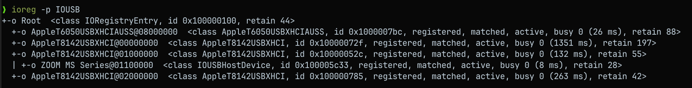
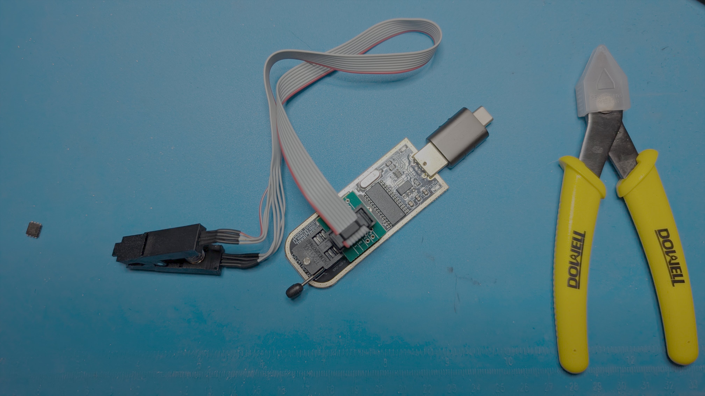
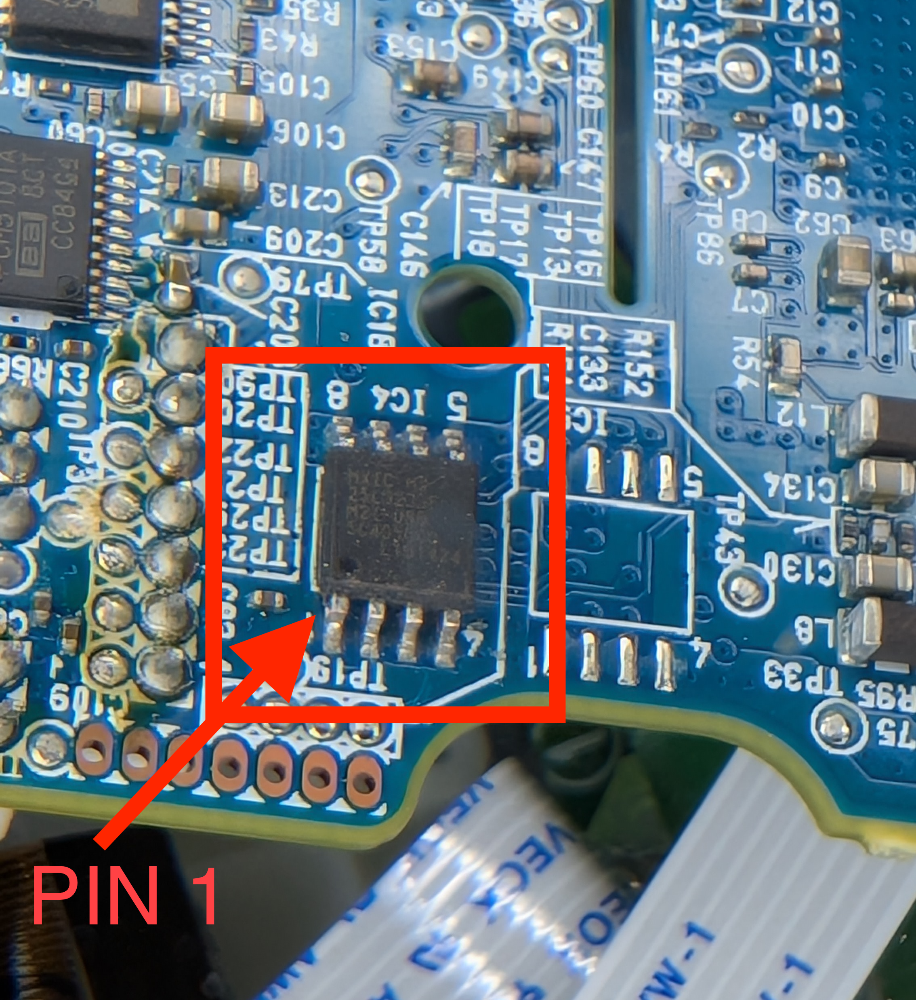
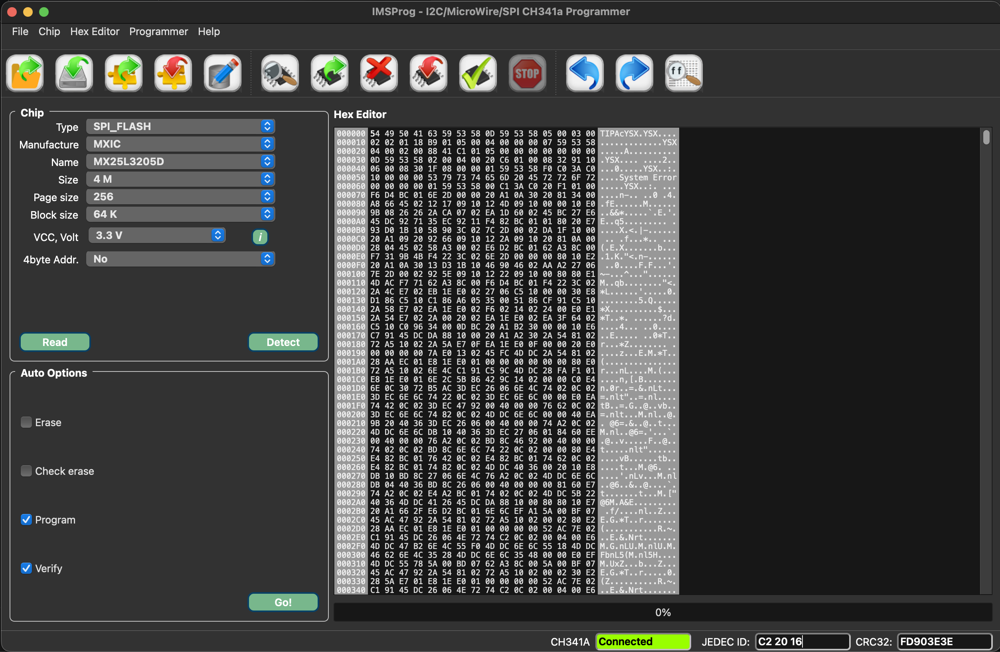
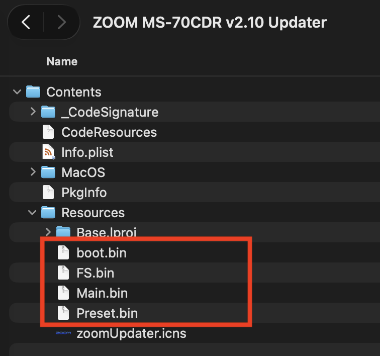
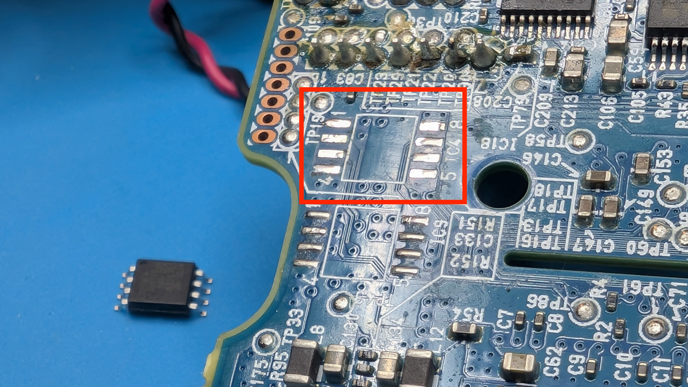
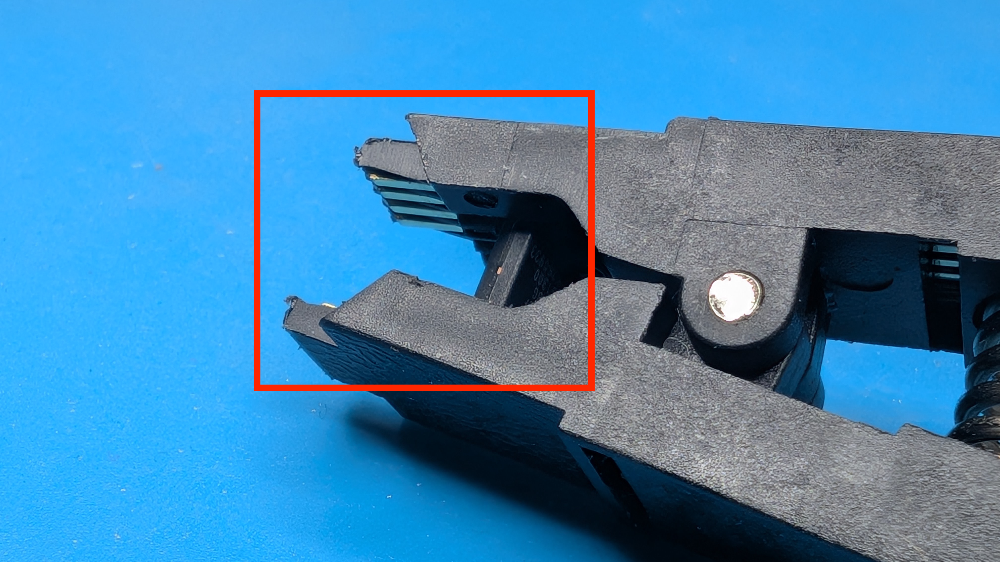

# ZOOM FX PEDAL DE-BRICK

## Preamble
If your Zoom FX pedal (MS-70CDR, MS-50G... NOT the latest crop, i.e. CDR+) bricked due to a firmware update, the steps in this guide should help you get it working again. You're following this guide at your own risk, level of expertise and comfort. Soldering surface-mount components (if needed) requires experience and adequate equipment. If you don't have those, Google 'maker meetup' in your area, and I'm you'll find people happy to help out.

**[This Reddit post](https://www.reddit.com/r/zoommultistomp/comments/1t4o6zf/unbrick_zoom_ms_70cdr_using_ch341a_rom_writer/) provided invaluable information** and it might be all you need, so check it out first.

## Context
After the official Zoom MS-70CDR firmware upgrade from v2.00 to v2.10, the pedal continued working fine in 'Normal mode', but it would no longer connect to any of my computers in 'Firmware update' mode.

At first, I thought that maybe the problem was a conflict with v2.10 and my Macbook Pro M5 running Tahoe, so I also tried a Linux x86 computer, and even an old Windows PC. Regardless of the computer/OS/CPU, the pedal would only enumerate as a USB device in 'Normal mode':

I contacted Zoom support, and they were fantastic, but unfortunately there is no way to update firmware when 'Firmware update' mode isn't working.

If you find yourself in this predicament, here are the steps in increasing order of despair and difficulty:
 1. Your cable is bad. Try a different one.. (unlikely to work, but it may give a brief feeling of purpose and hope)
 2. Try a different computer. If the device enumerates in 'Firmware update' mode, (re)update the firmware on that computer, and hope hope that it will start working everywhere else.
 3. If you're here, you'll need to flash your pedal's firmware with a [CH341A programmer](https://www.amazon.com/dp/B07VNVVXW6?ref=ppx_yo2ov_dt_b_fed_asin_title). This means taking your pedal apart, so that you can access the flash ROM chip - [this](https://www.mouser.com/en/ProductDetail/95-25L3233FM2I08TR) little guy. Step 3 comes in two flavors:
	 3a. EASY - the SOIC8 clip reliably reads and writes to the MX25L3233F flash ROM chip.
	 3b. HARD - the SOIC8 clip can't reliably communicate with the MX25L3233F flash ROM chip. You'll need to remove the flash ROM chip from the mainboard, and solder back a newly programmed one. If you have the tools and know how, this won't be a problem. Otherwise, find someone who's done this before. 

## STEP 3: CH341A FLASH ROM PROGRAMMING

 - Disassemble the FX pedal, so that the side of the mainboard with the flash ROM chip is facing up.

 - Connect the SOIC8 clip to the ROM chip, making sure that the red cable is on pin 1 (look for a dot/indentation on the chip)
 - Connect the CH341A programmer to your computer, and fire up [IMSProg](https://github.com/bigbigmdm/imsprog)
	 - Click the 'Detect' button, and if you're lucky, it will detect your flash ROM chip, like so:

 - If you can detect and read from the ROM chip, do about 3 reads, and each time save a file. To verify that you are reliably reading the chip, compare saved files like this:
 
 > **shasum -a 256 rom-read1.bin rom-read2.bin rom-read3.bin**

If the files are identical, their corresponding hashes will be the same:

> eda0f5beabfcf78d90eda8ed3e36e6872125a97c106613f120b95ac69196f5cc rom-read1.bin
> eda0f5beabfcf78d90eda8ed3e36e6872125a97c106613f120b95ac69196f5cc rom-read2.bin
> eda0f5beabfcf78d90eda8ed3e36e6872125a97c106613f120b95ac69196f5cc rom-read3.bin

If the files are identical, build the composite flash ROM from the official Zoom firmware, using the provided [Python script](create-firmware-full-4MB.py):

On a Mac, to create the MS70CDR_FIRMWARE_FULL_4MB.bin composite ROM file, run:

> python3 create-firmware-full-4MB.py

Open, write and verify the composite flash ROM file onto the ROM chip using IMSProg. Once written, do another read from the ROM chip, and run: 

> **shasum -a 256 MS70CDR_FIRMWARE_FULL_4MB.bin just-read-rom.bin**

If the checksums are identical, your ROM chip is reprogramed and you can reassemble the pedal. You're done!
Otherwise..
#### ROM CHIP REMOVAL

If you can't reliably read from the ROM chip, you'll needed to remove it from the mainboard in order to program it. This isn't hard if you have the tools, and you know how to use them, but it could be costly if you have to buy the tools just for this job, and also learn how to use them (and you could also ruin the FX pedal in the process). With that motivational message out of the way:
 - Remove the ROM chip from the mainboard:
	 - If intact, attach the SOIC8 clip and you should be able to follow the IMSProg steps above. When done programming, solder it back, and you're good to go.
	   
	 - If you destroyed the chip (you snipped it off, or whatever unspeakable harm was done to it), order a new one (or several - they're cheap) from [Mouser](https://www.mouser.com/en/ProductDetail/95-25L3233FM2I08TR), program the new chip using the SOIC8 clip (above), verify, and then solder it back.

If everything went well, your pedal is now working - YAY!
If it's not working, retrace your steps, or ultimately - seek help!
